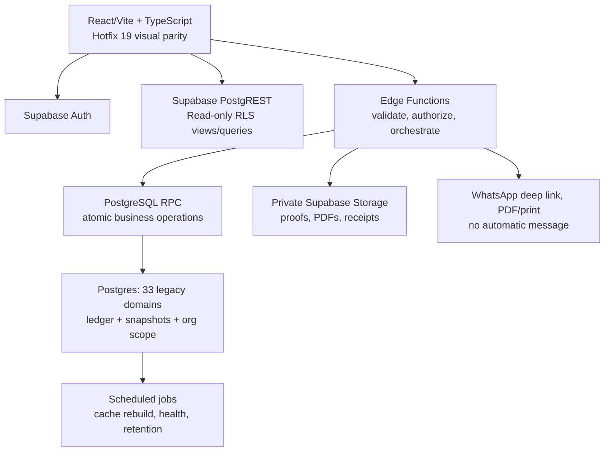

# ARCHITECTURE — Supabase Rebuild

## 1. System overview



## 2. Frontend stack

- React + TypeScript + Vite, router, query cache (TanStack Query atau padanan), React Hook Form/Zod (atau padanan), Playwright.
- Port desain dari `Page*.html`, `Styles*.html`, `Js*.html`; utamakan kesetaraan 12 layar.
- `supabase-js` memakai publishable key + user session **hanya untuk operasi baca yang RLS-authorized**. Auth role tidak dipercayakan ke local state atau parameter client.
- Mutasi bisnis besar dijalankan lewat Edge Function `POST /functions/v1/{domain}/{action}` atau RPC yang diaudit, bukan `.insert` ke ledger via browser.
- Real-time subscription **opsional** untuk status order/batch dan hanya channel dengan RLS; awalnya refresh/polling cukup.

## 3. Persistence strategy

- `public.organizations`, `public.memberships` mengikat `auth.users` ke satu org/role.
- Semua 33 tabel bisnis menyimpan `org_id` dan **ID lama sebagai business key** (untuk linkage dan migrasi). `(org_id, business_id)` adalah PK; referensi antar tabel composite FK di migration.
- Event ledger (`payments`, `transactions`, `inventory_movements`, `activity_log`) append-only melalui transaction API; koreksi menggunakan event lawan arah/void, bukan physical delete.
- Cache `inventory`, `daily_metrics`, `monthly_metrics`, KPI dan customer aggregate bisa di-rebuild dari transaksi; jangan jadikan sumber hitung awal.
- `payment_proofs` metadata file terpisah; `payments.proof_url` dipertahankan untuk **historical Google Drive URL** saat migrasi, bukan untuk new Supabase upload.
- Masa transisi: prefer write ke **satu** sumber saja. Hindari dual write GAS→Supabase tanpa reconciliation/outbox.

## 4. Atomic operation boundaries

| Operation | Harus satu transaksi DB | Efek file/eksternal |
|---|---|---|
| Record payment/refund | Lock invoice; check outstanding/refundable, unique reference; insert payment + transaction; recompute invoice/order | File upload/move di Storage adalah saga terpisah dengan cleanup/retry |
| Create/cancel order | Snapshot items, totals, capacity reservation, status transition, audit | Invoice PDF dibuat async setelah commit |
| Preorder reservation | Lock campaign; check cutoff/capacity; reserve booked quantity; create order | None |
| Purchase receive | Lock purchase line & inventory; guard received quantity and unique receipt event; update average cost + stock | None |
| Production usage | Lock plan/batch + inventory; unique source posting; block negative stock; record stock moves | Print ticket is read-only |
| Expense/finance posting | Insert expense + transaction once; void with reversal event | Receipt file private if added |

**Critical rule:** data business changes commit di DB sebelum scheduling PDF/notifications. Jika PDF gagal, simpan `job/outbox` untuk retry; tidak membatalkan pembayaran yang telah committed.

## 5. Storage design

| Bucket | Visibility | Object key | Access |
|---|---|---|---|
| `payment-proofs` | Private | `{org_id}/{YYYY}/{MM}/{YYYY-MM-DD}_{customer_slug}_{PAY-ID}.ext` | OWNER/FINANCE authorized, signed URL singkat |
| `invoice-pdfs` | Private by default | `{org_id}/{YYYY}/{MM}/{invoice_id}/rev-{n}.pdf` | Staff authorized; public invoice token endpoint bisa stream PDF terbatas |
| `product-images` | Public or private by decision | `{org_id}/products/{product_id}/{hash}.webp` | Tidak boleh bercampur dengan proof |
| `receipts` | Private | `{org_id}/{YYYY}/{MM}/{expense_id}/...` | Finance authorized |

**Upload proof:** request upload-intent auth → verify org/role + file metadata → signed upload to temporary private object → inspect MIME *and* magic bytes, max 8 MiB → transact payment once with reference → atomically allocate final payment ID/path in DB → move/copy within Storage → update metadata, idempotent retry/compensate stale file. Supabase DB+Storage bukan satu ACID transaction; gunakan state `PENDING/READY/FAILED`, job retry + cleanup.

## 6. Public invoice security

`GET /public/invoices/{opaque_token}` via Edge Function, scope strictly to invoice summary + line items + due/paid, no internal customer history or payment proof. Token at-rest hash (`sha256`) plus display only on issuance/rotation, short cache, rate-limits, optional revocation; nonmatching token returns indistinguishable 404. Token legacy dari Sheets boleh dirotasi saat cutover. WhatsApp content remains user-initiated.

## 7. IDs and time

Existing business IDs preserved; new IDs generated by DB `business_id_counters` with `INSERT ... ON CONFLICT DO UPDATE ... RETURNING` in same transaction. `ORD/PAY/INV/...` month scope; master `CUS/PRD/...` global scope per org. Never derive from row number or `MAX(id)+1`.

Use `timestamptz` (UTC internally) + `Asia/Jakarta` display. Dates `YYYY-MM-DD` are `date`; avoid timezone shifting date-only fields. Numeric quantities `numeric(20,6)`, money `bigint` Rupiah.

## 8. Code boundaries (suggested)

```text
src/
  app/{router,auth,providers,layout}/
  components/{cards,forms,modals,tables,print}/
  features/{executive,business,orders,preorders,customers,products,recipes,
            production,inventory,purchasing,finance,marketing,reports,settings}/
  lib/{supabase,api,formatters,permissions,errors}/
supabase/
  migrations/
  functions/{orders,payments,inventory,purchasing,production,public-invoice,reporting}/
  tests/
scripts/{export-sheets,import-staging,reconcile}/
tests/{unit,integration,e2e,visual}/
```

## 9. Environment and release

Separate **DEV/STAGING/PROD** with explicit project refs. A previously used Supabase project may already contain unrelated content/marketing schema; **do not push this scaffold there without inspection**. Migration files immutable after deployment; use new numbered migration for changes. CI: lint/typecheck, SQL lint/migrate on fresh local DB, pgTAP RLS/concurrency, browser tests, dry-run import, backup, phased cutover. Rollback via release re-route + database restore strategy, **not drop-and-recreate** in production.
