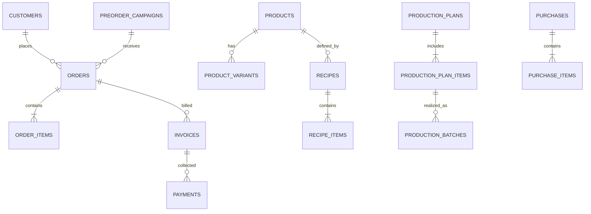

# DATA_MODEL — 33-table Legacy Crosswalk → Postgres

## 1. Shape

The original schema has **33 canonical logical tables**. `supabase/migrations/202610280001_initial_schema.sql` preserves their original `snake_case` fields and stable business IDs, adds `org_id` composite scope, data types, and relationship constraints where unambiguous. `public.organizations`, `public.memberships`, `public.payment_proofs`, and `public.business_id_counters` are **new infrastructure** and are not counted in 33. The SQL is a **fresh-project starter**, not a full live importer.

| Domain | Canonical tables | Source of truth |
|---|---|---|
| Config/Identity | `config`, `users`, `business_settings` | Settings/role identities; Auth session lives in `auth.users` |
| Commerce/CRM | `customers`, `preorder_campaigns`, `orders`, `order_items`, `invoices`, `payments` | Orders + order snapshot, payment event ledger |
| Catalog/BOM | `products`, `product_variants`, `ingredients`, `packaging`, `unit_conversions`, `recipes`, `recipe_items` | Immutable used-recipe versions and order price snapshot |
| Production | `production_plans`, `production_plan_items`, `production_requirements`, `production_batches` | Recipe/requirement snapshots and batch event |
| Stock/Purchasing | `inventory`, `inventory_movements`, `suppliers`, `purchases`, `purchase_items` | `inventory_movements`; current stock is projection |
| Finance | `expenses`, `transactions` | Transaction and expense ledger; managerial COGS/P&L |
| Growth/Management | `business_targets`, `marketing_campaigns`, `content`, `daily_metrics`, `monthly_metrics`, `activity_log` | Raw records/events; metrics derived/rebuildable |

**Field-by-field source table**: `reference/LEGACY_SHEET_SCHEMA.md`; **machine-readable**: `reference/LEGACY_SCHEMA_MANIFEST.json`.

## 2. Relationship sketch



**Polymorphic links** (`item_type` + `item_id` for INGREDIENT/PACKAGING, `reference_type` + `reference_id`) cannot be safely constrained by ordinary single FK; validate in transactional services or add explicit typed reference tables/triggers after import.

## 3. Data typing / conversion

| Sheets type | PostgreSQL | Import rule |
|---|---|---|
| `IDR integer` | `bigint` | Strip separators/Rp, integer only, no NaN |
| `Decimal`, `Decimal IDR` | `numeric(20,6)` | Dot-decimal canonical; never JS float for accumulation |
| `Date` | `date` | Reject ambiguous `MM/DD/YYYY`; parse `YYYY-MM-DD` |
| `ISO datetime` | `timestamptz` | Retain time instant; absent TZ interpreted as Asia/Jakarta only with explicit rule |
| `Time` | `time without time zone` | HH:mm with zero padding |
| `Boolean` | `boolean` | TRUE/FALSE and Boolean, blank policy per field |
| `JSON String` | `jsonb` for `activity_log.*_json` | Parse and validate; old malformed rows quarantined |
| `String/JSON` settings | `text` initially | Preserve legacy raw value + `value_type`; typed accessor decodes |
| `Enum` | `text` + checks for key statuses | Add stronger domain enums in reviewed migrations |
| `URL` | `text` | Preserve legacy Google links; private Storage uses new path metadata |

## 4. Invoice / payment formulas

```text
successful = SUM(payments.amount WHERE status='SUCCESS')
refunded   = SUM(payments.amount WHERE status='REFUND')
net_paid   = successful - refunded
remaining  = max(0, invoice.grand_total - net_paid)
```

Allowed invoice states: DRAFT, SENT, WAITING_PAYMENT, PARTIAL, PAID, OVERDUE, CANCELLED, REFUNDED. Payment rows: SUCCESS, REFUND, FAILED. Recalculate from ledger after each event; stale `paid_amount`, `remaining_amount`, `orders.payment_status`, `last_payment_method` must be corrected from source. Last method = latest successful payment by `payment_at` then `payment_id` tie-break. Keep **receipt events** separate from payment proof media.

## 5. Inventory / production

`stock = SUM(quantity_in_base - quantity_out_base)` per org + item_type + item_id. `inventory.current_stock_base` is a projection/cache. Production plan item remembers `recipe_id`, `recipe_version`, target, multiplier; requirement rows store `required_qty_base` *at time planned*. Purchasing `purchase_items.received_qty_base` is derived from uniquely posted receive events, not manually overwritten by the browser. Average material cost uses weighted average on receipt; COGS snapshots prevent catalog repricing from changing historical gross margin.

## 6. Key integrity rules

- Unique within org: customer/business IDs, SKU, invoice number, non-null `payments.reference_no`, invoice public token, metric `(metric_date,metric_key)`, `(month,metric_key)`, stock `(item_type,item_id)`.
- Composite FK includes `org_id` to prevent cross-org joins even when business ID matches.
- Avoid physical delete for any referenced historical record. Archive/status instead.
- For `payments`, `inventory_movements`, `transactions`, `activity_log` do not offer direct browser `DELETE/UPDATE`. Corrections become auditable compensating events.
- `invoice_url` is preserved as old generated link during import but generated URL in new runtime must come from verified app base domain.
- Historical file proof Drive URLs remain readable as references *if* Drive permissions permit; migrate files separately before removing old system.

## 7. Changes needed after initial import

Consider adding `currency`, `tax_breakdown`, `cancel_reason`, `stock_lot`, `unit_conversion_snapshot`, `payment_proof_state`, `outbox_jobs`, `audit_request_id`, export jobs, `auth_user_id` verified links, versioned invoice PDFs. These are recommended future columns/tables; **not silently part of baseline**.
